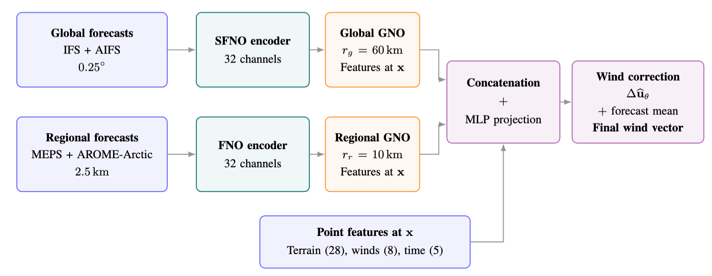

# windcast

10 m wind forecasts at 1 km over Northern Norway, 0–66 h ahead. **WindCast** corrects four
operational forecasts (IFS, AIFS, MEPS, AROME-Arctic) for the local terrain with neural operators,
and runs in real time.

**Live forecast: <https://chensy618.github.io/windcast/>**. It is updated after every 00 / 12 UTC run,
with station observations every hour.

## WindCast

A dual-scale graph neural operator (`windcast/training/train_dual_gno.py`) predicts the
obs-forecast residual of the 10 m wind against the mean of the four forecasts:

- **Inputs:** 10u, 10v, 2t and msl of each model, plus the terrain of the target point. No
  coordinates and no observations as input, so the same weights apply at any point (station or
  1 km cell).
- **Training:** observations of 99 Norwegian weather stations (MET Norway Frost).
  - Stations are split into 5 spatial groups. Each model is trained without one group and scored
    only on the stations it never saw.
  - 3 seeds per group, so the forecast is the mean of 15 models.
- **Configuration:** width 16, 8 × 16 spectral modes, 4 layers, about 0.15 M parameters. The full
  table is in the report.

### Results

Vector RMSE (m/s) at held-out stations, all lead times, on samples with a MET Nordic analysis.
± is the s.d. of a bootstrap over test runs (`notebooks/06_four_fields.ipynb`).

| Forecast | Original period¹ | Extended period² |
|---|---|---|
| IFS | 3.562 ± 0.033 | 3.772 ± 0.037 |
| AIFS | 3.541 ± 0.035 | 3.746 ± 0.038 |
| MEPS | 3.564 ± 0.036 | 3.760 ± 0.035 |
| AROME-Arctic | 3.552 ± 0.035 | 3.655 ± 0.032 |
| MET Nordic analysis (valid time) | 3.117 ± 0.028 | 3.332 ± 0.032 |
| **WindCast** | **3.153 ± 0.029** | **3.256 ± 0.028** |

¹ train 2024-03 – 2024-12, test 2025-04-01 – 2025-09-12.
² train 2024-03 – 2025-12, test 2026-04-01 – 2026-11-14.

WindCast is a forecast, but it comes close to the MET Nordic analysis, which already knows the
observations at the valid time. In the extended period it beats the analysis.

**Ablation** (`notebooks/07_ablation.ipynb`, original period, 3 seeds each). The terrain features
and the MLP head matter most: removing either raises RMSE by about 0.05 m/s. Dropping the global
branch costs 0.01 m/s. The GNO readout (vs bilinear sampling) and the regional branch change it
by less than the seed spread. Starting from the four-model mean gives no gain.

## Data and licences

- Forecasts:
  - ECMWF IFS and AIFS open data (CC BY 4.0).
  - NOAA GFS.
  - MET Norway MEPS and AROME-Arctic (CC BY 4.0).
- Observations and analysis: MET Norway Frost station observations and the MET Nordic analysis
  (CC BY 4.0).
- Terrain: Kartverket DTM 50 m (Geonorge, CC BY 4.0).
